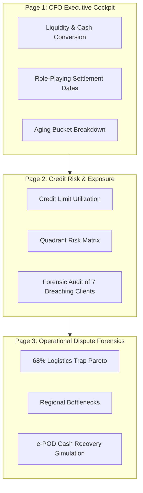
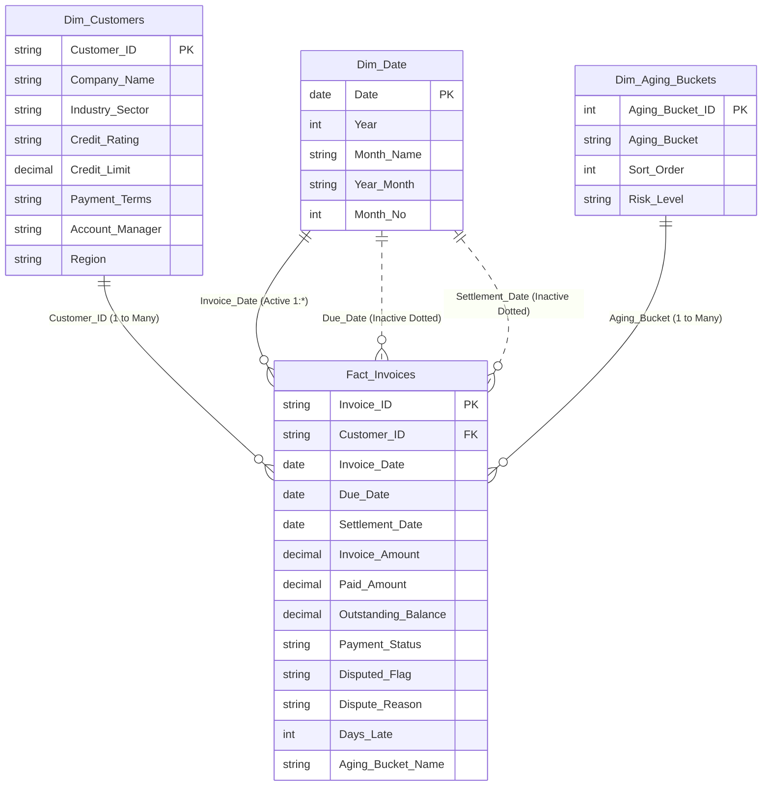

# Enterprise B2B Accounts Receivable & Credit Risk Analytics
### Strategic Working Capital Management, Dispute Forensics & e-POD Cash Recovery Simulation


**Author:** Muh Haikal Akbar, S.E.  
**Specialization:** Data & Business Intelligence Analyst | Corporate Financial Acumen  
**Enterprise Context:** PT Solusi Niaga Korpora (National Fast-Moving Consumer Goods & Enterprise Distribution)  
**Tools & Tech:** Microsoft Power BI Desktop, DAX (Data Analysis Expressions), Power Query (M Engine), Star Schema Data Modeling.

---

## Executive Summary

**PT Solusi Niaga Korpora** booked an impressive **IDR 403.2 Billion** in invoiced sales across 100 enterprise corporate accounts. However, behind this top-line revenue growth lay a severe working capital crisis:
* Out of **IDR 48.47 Billion** in total accounts receivable, **IDR 38.95 Billion (80.36%) had passed its due date (*Overdue AR*)**.
* The 45-day average collection delay generated an annual **IDR 432.17 Million in tied-up working capital bank loan interest (*Cost of Tied-Up Capital*)**.
* **IDR 10.0 Billion** in receivables was frozen under formal dispute (*Disputed Invoices*).

Rather than serving as a passive reporting tool, this 3-page executive Power BI analytics system was engineered to diagnose root causes, uncover credit compliance violations, and simulate a **prescriptive cash recovery intervention worth IDR 6.81 Billion**.

---

## Dashboard Architecture & Visual Showcase

The solution is architected into three dedicated executive interfaces built for QHD (2560 x 1440) widescreen displays:



### 1. Page 1: Executive AR Overview (CFO Cockpit)
* **Target Audience:** Chief Financial Officer (CFO), Treasury Director.
* **Core Function:** Monitors overall collection velocity, displays liquidity gaps using role-playing dates, tracks the 5 aging buckets, and flags tied-up capital cost.
* **Key Metric:** `Cost of Tied-Up Capital = IDR 432.17M` at 9% p.a. bank working capital financing.

### 2. Page 2: Credit Risk & Portfolio Exposure (Risk Committee)
* **Target Audience:** Credit Risk Committee, Chief Commercial Officer (CCO).
* **Core Function:** Evaluates approved credit lines (IDR 122B) against real exposure, maps debtor scatter clusters, and performs an automated forensic audit on limit breaches.
* **Key Metric:** **7 Clients Breaching Limits by +IDR 1.283B** due to sales manager manual override vulnerabilities.

### 3. Page 3: Operational Disputes & Root Cause Analysis (COO & Audit)
* **Target Audience:** Chief Operating Officer (COO), Head of Supply Chain & Internal Audit.
* **Core Function:** Isolates invoice dispute drivers, highlights regional fulfillment failure hotspots, and simulates electronic proof-of-delivery cash impact.
* **Key Metric:** **IDR 6.81B e-POD Recoverable Cash** by eliminating Missing POD (34.0%) and Quantity Mismatch (34.1%).

---

## Data Architecture & Modeling (Star Schema)

The analytical data model implements an optimized **Star Schema with Role-Playing Date Dimensions**:



### Why Role-Playing Dates Matter:
In B2B enterprise sales, transactions move through three distinct timeline milestones:
1. `Invoice_Date` (When billing is issued)
2. `Due_Date` (When payment is legally expected)
3. `Settlement_Date` (When actual cash lands in the corporate bank account)

Connecting all three dates to a single `Dim_Date` table without duplication avoids data bloating while allowing the hero measure `USERELATIONSHIP` to calculate true cash flow by settlement date.

---

## Core DAX Formulations (Financial & Risk Engineering)

### 1. The Role-Playing Hero Measure (True Cash Inflow)
```dax
Cash Collected by Settlement Date = 
CALCULATE(
    [Total Cash Collected],
    USERELATIONSHIP(Fact_Invoices[Settlement_Date], Dim_Date[Date])
)
```

### 2. Cost of Tied-Up Capital (Loan Interest Drag)
```dax
Cost of Tied Up Capital = 
[Total Overdue AR] * 0.09 * (45 / 365)
```

### 3. Credit Limit Breach Detection (Iterative SUMX & Filter)
```dax
Credit Breach Amount = 
SUMX(
    Dim_Customers,
    VAR SaldoPiutang = [Total Outstanding AR]
    VAR PlafonKredit = Dim_Customers[Credit_Limit]
    RETURN IF(SaldoPiutang > PlafonKredit, SaldoPiutang - PlafonKredit, 0)
)
```

### 4. Breach Clients Count
```dax
Breach Clients Count = 
COUNTROWS(
    FILTER(
        Dim_Customers,
        [Total Outstanding AR] > Dim_Customers[Credit_Limit]
    )
)
```

### 5. e-POD Recoverable Cash Simulation
```dax
e-POD Recoverable Cash = 
CALCULATE(
    [Disputed AR Exposure],
    Fact_Invoices[Dispute_Reason] IN {
        "Missing Proof of Delivery (POD)", 
        "Quantity Mismatch"
    }
)
```

---

## Key Analytical & Forensic Discoveries

### Discovery 1: "The Big Fish Paradox" (Flaw of Credit Rating Assumptions)
* **Initial Management Hypothesis:** *"Overdue receivables are driven by undercapitalized small vendors (Rating B and BB)."*
* **Data Reality:** High-risk clients (Rating B and BB) accounted for merely **14.38% (IDR 5.6B)** of overdue AR.
* **The Revelation:** **56.93% (IDR 22.17B) of all overdue debt was held by Tier-1 clients (Rating A and AA)**. Large corporate buyers intentionally leveraged their high bargaining power to delay payments, utilizing the distributor as a free working capital buffer (*Treasury Arbitrage Strategy*).

### Discovery 2: Credit Limit Breach Leakage (IDR 1.283 Billion)
* Cross-referencing master customer limits against current ledgers exposed **7 enterprise clients exceeding credit limits**.
* **Forensic Root Cause:** Sales managers held emergency manual override permissions in the ERP. Driven by monthly billing quotas, overrides were systematically granted without credit risk committee review.
* **Top Violators:** PT Mitra Semesta (+IDR 392M over limit), PT Makmur Teknologi (+IDR 317M over limit), PT Duta Utama (+IDR 221M over limit).

### Discovery 3: The 68% Logistics Trap in Disputed Invoices
* While commercial teams suspected client dissatisfaction stemmed from defective goods, Pareto analysis proved that **68.12% (IDR 6.81 Billion) of disputed AR was caused by physical fulfillment logistics**:
  * **Quantity Mismatch:** IDR 3.41 Billion (34.10%)
  * **Missing Proof of Delivery (POD):** IDR 3.40 Billion (34.02%)
* Lost paper delivery notes and physical count discrepancies created legal loopholes for clients to indefinitely freeze settlement.

---

## 4-Pillar Strategic Policy Recommendations

| Pillar | Strategic Business Action | Operational Mechanism | Projected Financial Impact |
| :--- | :--- | :--- | :--- |
| **1. Prompt Settlement Incentive** | **2/10 Net 30 Cash Discount** | Offer a 2% discount to Rating A/AA clients settling within 10 days of billing. | Recovers **IDR 7.0 Billion cash within 15 days**; cuts DSO by 18 days. Discount cost is cheaper than 9% bank interest + default risk. |
| **2. Logistics Verification Digitalization** | **Electronic Proof of Delivery (e-POD)** | Replace manual paper forms with driver smartphone GPS timestamps, barcode item verification, and digital recipient signatures. | Immediately resolves **IDR 6.81 Billion in logistics disputes**, eliminating settlement freezes. |
| **3. Commercial Incentive Realignment** | **Cash-Collected Sales Commission** | Shift sales commissions from 100% upon invoice generation to **50% upon invoicing and 50% upon actual cash collection**. Impose bonus freezes on accounts overdue >60 days. | Eliminates reckless credit expansion and aligns sales team behavior with cash flow survival. |
| **4. Systemic Risk Hard-Lock** | **ERP Credit Hard-Lock Automation** | Revoke manual override authority from sales managers. Hard-code automated shipment holds once a debtor hits 100% of their credit limit. | Prevents recurring credit leakage of **IDR 1.28 Billion** annually. |

---

## Validation Summary & KPI Target Matrix

| Measure Name | Validated Result | Status |
| :--- | :--- | :---: |
| **Total Invoiced Sales** | `IDR 403,196,600,000` (~IDR 403.2B) | Verified |
| **Total Cash Collected** | `IDR 354,725,700,000` (~IDR 354.7B) | Verified |
| **Total Outstanding AR** | `IDR 48,470,900,000` (~IDR 48.47B) | Verified |
| **Collection Rate %** | `87.98%` | Verified |
| **Total Overdue AR** | `IDR 38,948,800,000` (~IDR 38.95B) | Verified |
| **Overdue AR Ratio %** | `80.36%` | Verified |
| **Cost of Tied-Up Capital** | `IDR 432,176,679` (~IDR 432.2M) | Verified |
| **Total Approved Credit Limit**| `IDR 121,550,000,000` (~IDR 121.55B)| Verified |
| **Breach Clients Count** | `7 Clients` | Verified |
| **Credit Breach Exposure** | `IDR 1,283,000,000` (~IDR 1.283B) | Verified |
| **Disputed Invoices Count** | `400 Invoices` (12.50% Dispute Rate)| Verified |
| **Disputed AR Exposure** | `IDR 9,995,700,000` (~IDR 10.0B) | Verified |
| **e-POD Recoverable Cash** | `IDR 6,809,100,000` (~IDR 6.81B) | Verified |

---

## Author & Contact

**Muh Haikal Akbar, S.E.**  
*Data & Business Intelligence Analyst*  
*Specialized in Corporate Finance, Credit Risk Analytics & Working Capital Optimization*  
* [LinkedIn Profile](https://linkedin.com)  
* [GitHub Repository](https://github.com)  
* Email: haikalakbar.biz@gmail.com
